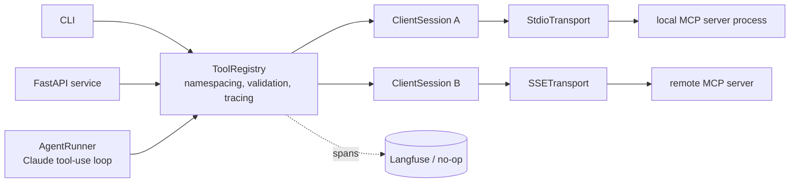

# mcp-orchestrator

A production-style **Model Context Protocol (MCP) client** in Python. It connects to any number of MCP
servers over **stdio** and **HTTP+SSE**, merges their tools into one namespaced, schema-validated
registry, traces every call (optionally to **Langfuse**), and exposes the result as a **FastAPI**
service and as a Claude tool-use loop.

The protocol layer (JSON-RPC 2.0, the MCP handshake, both transports) is written from scratch on top of
`asyncio`, `httpx` and `pydantic`. The official MCP Python SDK is used only for the demo server and for
integration tests, so the client is checked against an independent implementation of the protocol.

## Features

- **JSON-RPC 2.0** request/response correlation with per-request timeouts and `notifications/cancelled`
- **Two transports** behind one interface: subprocess **stdio** and remote **HTTP+SSE**
- **Typed models** (pydantic) for tools, results and content blocks; unknown content types do not break the client
- **Tool registry** that aggregates many servers, namespaces tools as `server__tool`, and keeps names valid for
  the Anthropic API (`[A-Za-z0-9_-]`, max 64 chars)
- **Argument validation** against each tool's JSON Schema *before* a call leaves the process
- **Failure isolation**: one server failing to connect does not stop the others; live `tools/list_changed` refresh
- **Tracing**: a span per tool call and per agent run; Langfuse backend (SDK v3) or a no-op default
- **FastAPI service** (`/tools`, `/tools/{name}/call`, `/chat`, `/healthz`) and a **CLI**
- **Claude tool-use loop** that feeds tool errors back to the model instead of crashing
- **Docker Compose** stack and **GitHub Actions** CI

## Architecture



| Module | Responsibility |
|---|---|
| `jsonrpc.py` | JSON-RPC 2.0 message models, encoding, strict parsing |
| `transports/` | `StdioTransport`, `SSETransport` (with an SSE parser), in-memory transport for tests |
| `session.py` | Handshake, id correlation, timeouts, pagination, server-initiated pings |
| `models.py` | Typed MCP schema subset |
| `registry.py` | Multi-server tool catalogue, validation, traced calls |
| `tracing.py` | `Tracer` protocol, Langfuse and recording tracers |
| `agent.py` | Claude Messages API tool-use loop |
| `api.py`, `cli.py` | HTTP service and command line |

## Quick start

```bash
pip install -e ".[dev]"          # Python 3.11+
mcp-orchestrator list-tools --config examples/servers.toml
mcp-orchestrator call --config examples/servers.toml demo__add --args '{"a": 2, "b": 40}'   # prints 42
```

### Docker Compose

```bash
docker compose up --build
curl localhost:8000/healthz
curl -X POST localhost:8000/tools/remote__add/call \
  -H 'content-type: application/json' -d '{"arguments": {"a": 2, "b": 3}}'
```

The stack starts a demo MCP server reachable over HTTP+SSE and the orchestrator, which also launches a
second copy of the demo server over stdio, so both transports are exercised.

### As a library

```python
import asyncio
from mcp_orchestrator import ToolRegistry, load_config


async def main():
    async with ToolRegistry() as registry:
        await registry.connect_all(load_config("examples/servers.toml"))
        print([t.name for t in registry.tools()])  # ['demo__add', 'demo__word_count', ...]
        result = await registry.call("demo__add", {"a": 2, "b": 3})
        print(result.text)  # 5


asyncio.run(main())
```

A single connection, without the registry:

```python
import asyncio, sys
from mcp_orchestrator import ClientSession, StdioTransport


async def main():
    async with ClientSession(
        StdioTransport(sys.executable, ["examples/demo_server.py"])
    ) as session:
        print(session.server_info.name, session.protocol_version)  # demo 2025-03-26
        result = await session.call_tool("word_count", {"text": "hello brave new world"})
        print(result.text)  # 4


asyncio.run(main())
```

### Server configuration

```toml
[[servers]]
name = "local"
transport = "stdio"
command = "python"
args = ["examples/demo_server.py"]

[[servers]]
name = "remote"
transport = "sse"
url = "http://localhost:8001/sse"
headers = { Authorization = "Bearer ${TOKEN}" }   # ${VAR} is expanded from the environment
```

## Tracing with Langfuse

Set `LANGFUSE_PUBLIC_KEY`, `LANGFUSE_SECRET_KEY` (and `LANGFUSE_HOST` for self-hosted) and install the extra
(`pip install ".[langfuse]"`). Every `registry.call(...)` then produces an observation named
`mcp.call_tool.<server>__<tool>` with the arguments, the output, the server, the tool and the duration in
milliseconds. Failed calls, invalid arguments and timeouts are marked `ERROR`. Agent runs produce an `agent.run`
observation. Without credentials the tracer is a no-op. Tracing failures are logged and never break a tool call.

## Claude tool-use loop

`POST /chat` (needs `ANTHROPIC_API_KEY`) or `AgentRunner` in code. The registry's tools are passed to the
Messages API, the model's tool calls are executed concurrently, and failures (bad arguments, unknown tool,
server error) come back to the model as `is_error` tool results so it can correct itself.

## Design notes

- **Validate first.** Arguments are checked against the tool's `inputSchema` locally, so malformed calls never
  reach a server and the error lists every problem with its path.
- **Typed errors.** `InvalidToolArguments`, `ToolNotFound`, `ToolExecutionError`, `RequestTimeout`,
  `SessionClosed`, `TransportError`, `ProtocolError` and `JSONRPCError` all derive from `MCPError`; the HTTP API
  maps them to 422, 404, 502, 504, 503 and 502.
- **SSE endpoint origin check.** The `endpoint` event may only point at the same origin as the stream URL,
  otherwise the client refuses to POST there.
- **Robust stdio.** Non-JSON lines on a server's stdout are skipped, messages up to 16 MiB are accepted, and
  shutdown escalates from closing stdin to `terminate` to `kill`.
- **Version negotiation.** The client proposes `2025-03-26` and accepts `2025-06-18`, `2025-03-26` and
  `2024-11-05`; anything else fails the handshake with a clear error.

## Tests

```bash
pytest --cov            # unit + integration
ruff check . && ruff format --check .
```

The suite has 200 tests and, at the time of writing, 97% line and branch coverage (measured with `pytest-cov`,
CI fails below 95%). It covers:

- the JSON-RPC parser and typed models, including malformed input
- the session: out-of-order responses, timeouts, cancellation, server pings, dropped connections
- both transports against real subprocesses and a real HTTP server, plus mocked HTTP failures
- the registry: namespacing, validation, failure isolation, live tool refresh, tracing
- the agent loop with a scripted model, and the HTTP API
- **integration tests against a server built with the official MCP Python SDK**, over stdio and HTTP+SSE
- the Langfuse tracer against the real Langfuse SDK (with tracing disabled) to catch API drift

## Limitations

- Remote transport is the original **HTTP+SSE** transport; **Streamable HTTP** is not implemented yet.
- Tools only: resources, prompts, sampling, roots and elicitation are not implemented. Server-initiated
  requests other than `ping` are answered with "method not found".
- JSON-RPC batches are rejected (MCP does not use them).
- No benchmarks are published here yet; none of the numbers above are performance claims.

## License

MIT
